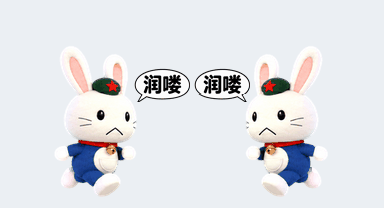
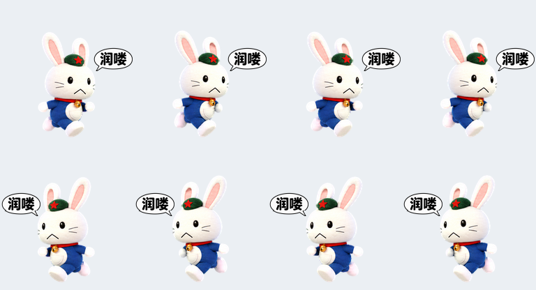

# 哆啦A兔 · 润喽移动版

戴红五星绿帽的毛绒白兔，无鼻子、折线下撇嘴，蓝色圆身体配白口袋和金铃铛；处理任务时抱着电脑工作。

兔子向左、向右移动时，脸部斜上方会出现写着 **“润喽”** 的漫画对话框。

## 移动效果

气泡已调整为更小、位置更高的版本：相较初版，宽度从 72 像素缩小到 56 像素，上移 23 像素，并向脸外侧留出空间，避免遮挡眼睛和嘴部。左右移动时文字均保持正向可读。

## 完整动作预览

以下完整动作 GIF、视频和关键帧均从当前版本的精灵图重新导出，包含移动时的“润喽”气泡。

[查看完整动作视频](assets/star-rabbit-all-states.mp4)

### 抱着电脑工作

## 下载与使用

- [透明背景精灵图 PNG](assets/star-rabbit-spritesheet.png)
- [左右移动 GIF](assets/movement-preview.gif)
- [移动关键帧 PNG](assets/movement-preview.png)
- [完整动作 GIF](assets/star-rabbit-all-states.gif)
- [完整动作视频 MP4](assets/star-rabbit-all-states.mp4)
- [全部动作关键帧 PNG](assets/star-rabbit-motion-stills.png)

点击文件后使用 GitHub 的下载按钮保存原始素材，也可通过 **Code → Download ZIP** 下载整个仓库。安装时使用 `star-rabbit-spritesheet.png`；预览 GIF 和 MP4 不是安装文件。下载仓库不会自动将宠物加入账号宠物库或切换当前宠物。

## 素材规格与修改范围

这是为 ChatGPT Work Pets 制作的 v2 精灵图：透明 PNG，尺寸为 **1536 × 2288**，8 列 × 11 行，每格 192 × 208 像素，包含九种动画状态和十六个视线方向。

本次只修改 `running-right` 和 `running-left` 两行，共 16 帧。其他动作与原始精灵图逐像素一致；工作动画中的电脑也保持不变。最终 PNG 已通过本地格式校验和 Work Pets 精灵图验证。

精灵图 SHA-256：

`d9682e4b999b9c2afbc0c049f288f6ffd054e6a89bcefc2a5c0f2f89f2745804`

